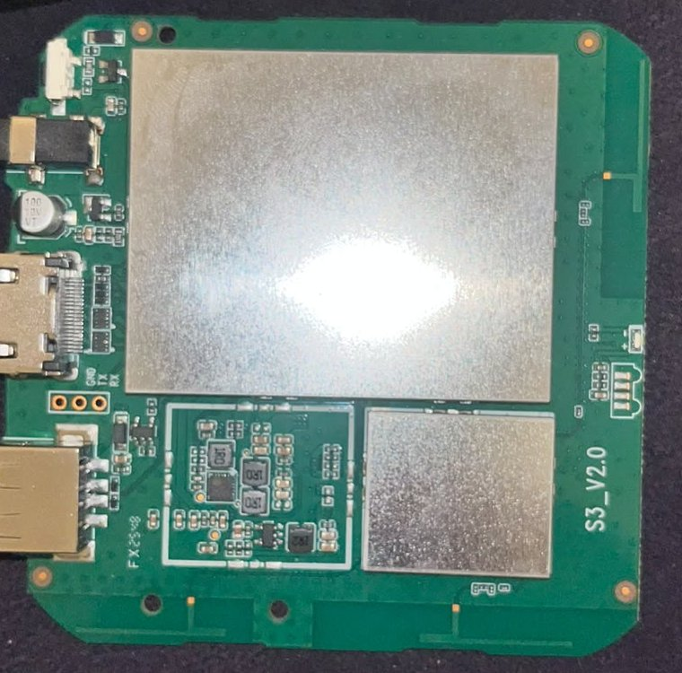

# fake-mi-box-fix

How I fixed a fake "Xiaomi Mi Box S" (board `S3_V2.0`, Allwinner H618, secure boot fused) with the Lemon TV Mini H618 Android 12 firmware.



> **WARNING.** This guide writes to the boot area and the eMMC of the box.
> A wrong step can leave the box dead. I tested it on **one unit**. There is no guarantee.
> Never run a PhoenixSuit or LiveSuit full flash. It can program the eFuse. The eFuse cannot be undone.
> No tool in this repository writes to the eFuse.

## What this is

Some boxes sold as "Xiaomi Mi Box S" are Allwinner H618 boards with the silkscreen `S3_V2.0`.
Secure boot is on and the root key hash is fused. A normal firmware does not boot.
The root key of the public Lemon TV Mini H618 firmware (v12.1.1.604) matches the fused key hash of my box.
This repository holds the guide and the host tools. It also holds the build recipe of a small RAM Linux. The backup and the install use that RAM Linux.
After the install the box boots Android 12 without a computer.

The full guide is in Turkish: **[REHBER.md](REHBER.md)**. Use your browser translation if you need English.
Commands, file names and tool output are in English.

The repository does **not** contain the firmware, eMMC dumps or built binaries.
You download the firmware from [Boxput](https://boxput.com/download/) and check its SHA-256.

## Is this for your box?

```text
Does the board say S3_V2.0?
├─ no  -> Stop. This repository is not for your box.
└─ yes -> Does `sunxi-fel ver` show SoC ID 0x1823?
          ├─ no  -> Stop.
          └─ yes -> Does tools/check_rotpk.py print MATCH?
                    ├─ no  (NO MATCH) -> Stop. Do not write anything.
                    └─ yes (MATCH)    -> Continue with the steps below.
```

A match shows that the key hash in the Lemon firmware equals the fused key hash of your box.
It does not prove that the firmware boots. The same board label does not prove the same DRAM chips.

## Steps

All steps are in [REHBER.md](REHBER.md).

| Step | What you do |
|:--|:--|
| [0](REHBER.md#adim-0) | Prepare, with no box connected. Build `sunxi-fel`. Download the firmware, check its SHA-256, unpack it, patch the DRAM values. |
| [1](REHBER.md#adim-1) | Put the box in FEL mode with the push button on the board. |
| [2](REHBER.md#adim-2) | ROTPK check. Go or no-go. |
| [3](REHBER.md#adim-3) | Build the RAM Linux in Docker. Start it over FEL. Open the USB console and the USB network. |
| [4](REHBER.md#adim-4) | Full backup of the eMMC. |
| [5](REHBER.md#adim-5) | Boot stage. Reboot check: a logo appears, the box does not return to FEL. |
| [6](REHBER.md#adim-6) | Prepare the GPT. Android stage. **This erases the old user data.** |
| [7](REHBER.md#adim-7) | First boot. Android 12, 32-bit apps only, no Google Play. |

You need a computer (macOS was tested) and Docker. You also need Python 3, about 30 GiB of free disk and a USB data cable. The cable goes into the USB-A socket of the board.

## What to expect after the install

- Android 12, 32-bit only (`armeabi-v7a` apps). No Google Play. Sideload APKs. ADB over Wi-Fi worked.
- 128 MB Java heap per app.
- HDMI menu is set to 1080p60. 4K HEVC did not decode. Use 1080p sources.
- Wi-Fi country code is CN. 5 GHz can be unreliable.
- A Bluetooth remote paired and worked.
- Slot B is empty. Do not take OTA updates.

## Tested and not tested

| Part | State |
|:--|:--|
| ROTPK match, boot stage, Android install, Android 12 first boot (with the original scripts) | Tested on one unit |
| RAM Linux (the tested build), USB console, USB network | Tested on one unit |
| Return to FEL with the button after the boot stage | Tested on one unit |
| The rewritten tools in `tools/` | **Not run on a device yet** |
| The rebuilt RAM Linux loader | **Not run on a device yet.** DTB, kernel and the nine modules match the tested build. |
| The `s3backup` CGI and `backup_emmc.py` | **Not run on a device yet** |
| A full 14.7 GiB backup | **Not done yet.** The test backed up the first 4.25 GiB and the GPT tail. |
| First FEL entry on a box in factory state | Not tested |
| A Linux host, an x86 Docker host, Windows | Not tested |
| Another unit, another board revision, another eMMC | Not tested |
| 4K, HDR, long runs, OTA | Not tested |

## Layout

| Path | Content |
|:--|:--|
| [REHBER.md](REHBER.md) | The full guide (Turkish). |
| [ramlinux/](ramlinux/README.md) | Build recipe of the RAM Linux: Dockerfile, `build.sh`, U-Boot config and patch, init and the backup CGI. |
| [tools/](tools/README.md) | Host tools and the `sunxi-fel` patch. |
| `docs/images/` | Photos of the board and the RAM Linux console. |

## Licence

[MIT](LICENSE), copyright 2026 Baran Başaran.
The device tree in `ramlinux/uboot` keeps its own SPDX header. Patches follow the licence of the project they patch.

## Disclaimer

This project is not affiliated with, endorsed by or sponsored by Xiaomi, Allwinner, Lemon or Boxput.
Product names and trademarks belong to their owners. They appear only to identify hardware and software.
Use this at your own risk.
