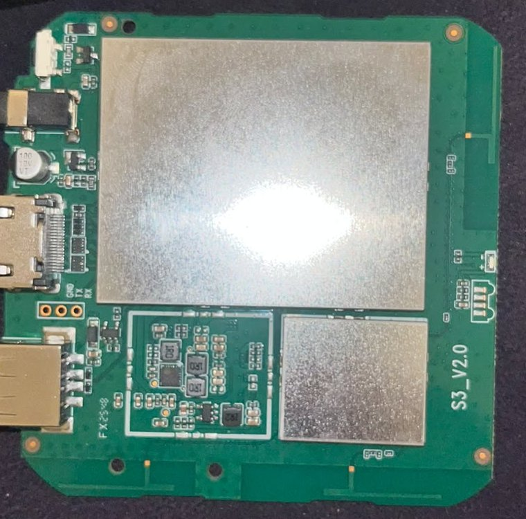
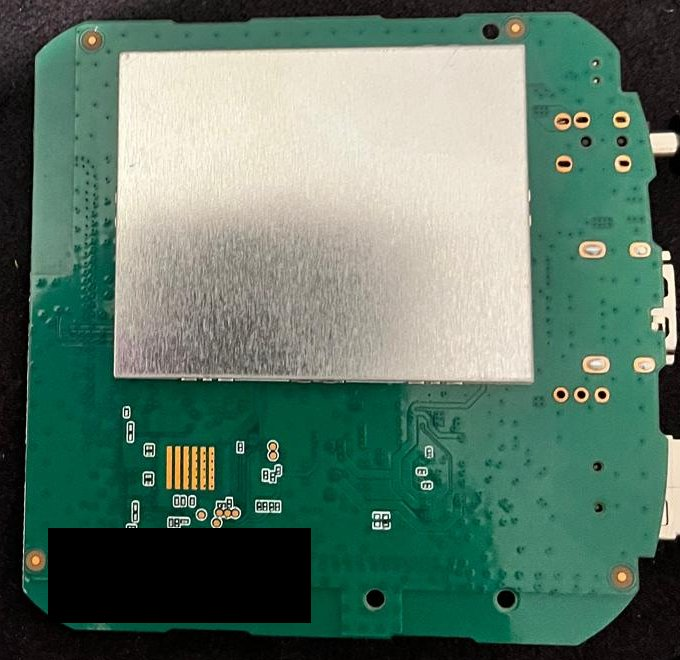
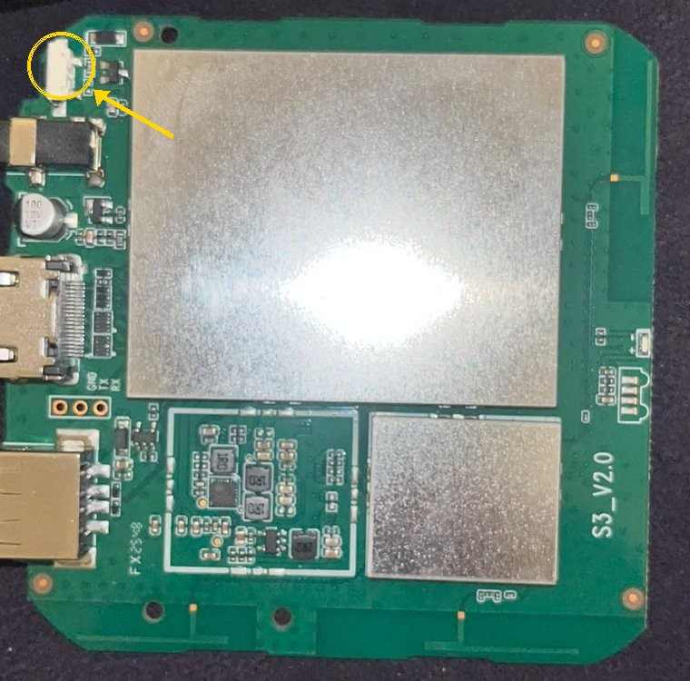
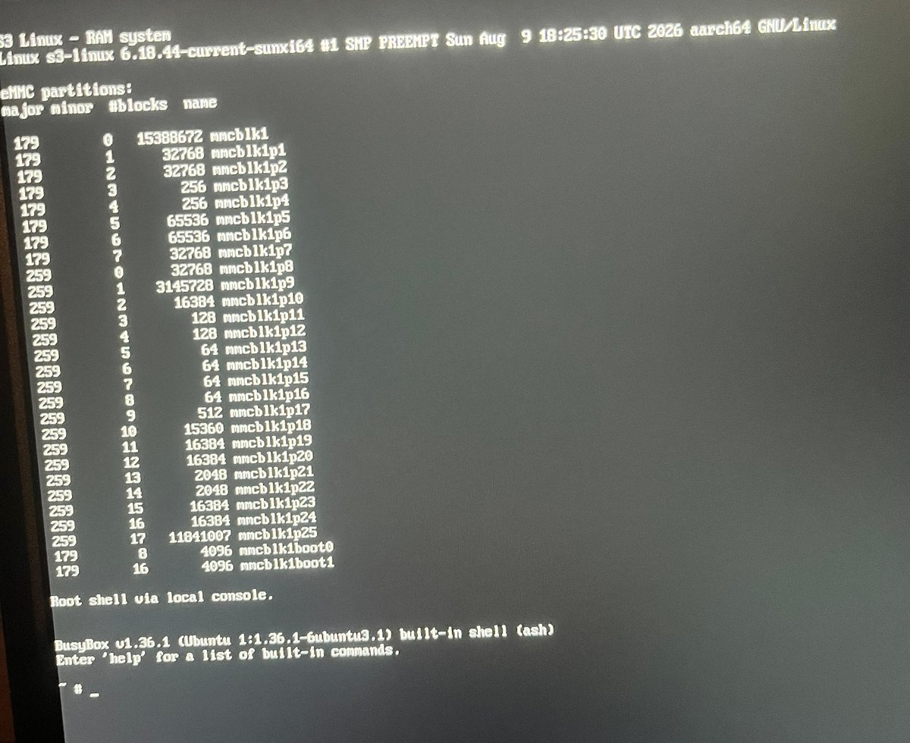

# Sahte Mi Box S (S3_V2.0) onarım rehberi

> **UYARI.** Bu rehber kutunun eMMC belleğine ve boot alanına yazar.
> Yanlış bir adım kutuyu açılmaz hâle getirir.
> Rehberi yalnız **bir kutuda** denedim. Garanti yok. Riski sen alırsın.
> Hiçbir adımda eFuse'a yazma. PhoenixSuit veya LiveSuit ile tam flash yapma.

Bu rehber, kartında `S3_V2.0` yazan sahte "Xiaomi Mi Box S" kutuları içindir.
Rehber kutuya Lemon TV Mini H618 Android 12 firmware'ini kurar.
Bu firmware'in kök anahtarı, kutunun güvenli önyükleme anahtarıyla eşleşir.
Kurulumdan sonra kutu bilgisayarsız açılır. Bilgisayar yalnız kurulum sırasında gerekir.

İngilizce kısa özet için [README.md](README.md) dosyasına bak.
Komutlar ve dosya adları İngilizce kalır.

## İçindekiler

1. [Bu kutu gerçekte nedir](#kutu)
2. [Kim için, neyi düzeltmez](#kim-icin)
3. [Kesin kurallar](#kurallar)
4. [Gerekenler](#gerekenler)
5. Adımlar
   - [Adım 0 — Hazırlık (kutu yok)](#adim-0)
   - [Adım 1 — FEL'e gir](#adim-1)
   - [Adım 2 — ROTPK kontrolü (git / gitme)](#adim-2)
   - [Adım 3 — RAM Linux'u derle ve başlat](#adim-3)
   - [Adım 4 — Tam yedek](#adim-4)
   - [Adım 5 — Boot aşaması](#adim-5)
   - [Adım 6 — GPT ve Android aşaması](#adim-6)
   - [Adım 7 — İlk açılış](#adim-7)
6. [Ne denedim, ne denemedim](#tablo)
7. [Sorun giderme](#sorun)
8. [Kaynaklar](#kaynaklar)
9. [Lisans ve sorumluluk](#lisans)

<a id="kutu"></a>
## 1. Bu kutu gerçekte nedir

Kutu bir Xiaomi ürünü değildir. Kutu, Allwinner H618 çipli bir karttır.
Kutu Xiaomi Mi Box S gibi görünür.
Sahipler benzer kutuları Allwinner, `sun50iw9p1`, 2 GB RAM ve taklit `MiTV-AFMU0` kimliğiyle bildirdi
([Reddit](https://www.reddit.com/r/MiBox/comments/1os7cph/fake_xiaomi_box_s_3rd_gen/)).
Başka bir sahip BigdroidOS adlı benzer bir kutuyu anlattı
([Reddit](https://www.reddit.com/r/AndroidTV/comments/1qii0n5/the_bigdroidos_scam_how_my_fake_xiaomi_tv_box_s/)).
Bu kutuların aynı kart olduğu doğrulanmadı. Kart yazısı ve ROTPK kontrolü karar verir.

| Özellik | Değer |
|:--|:--|
| Kart yazısı | `S3_V2.0` |
| SoC | Allwinner H618 (`sun50iw9p1`) |
| FEL kimliği | `0x1823` (H616 ailesi) |
| Platform adı | `apollo-p7` |
| Bellek | 2 GiB LPDDR3 |
| eMMC | DF4016, 14,7 GiB (30 777 344 sektör) |
| PMIC | AXP313A |
| Wi-Fi ve Bluetooth | RTL8822BS |
| Güvenli önyükleme | Açık. Kök anahtar özeti (ROTPK) eFuse'ta programlı. |
| Taklit kimlik | Xiaomi Mi Box S, `MiTV-AFMU0` |

`0x1823` kimliği H616 ve H618'i ayırmaz. Ben silikon kimliğini (SID) okumadım.
H618 firmware'i bu kartta sorunsuz çalıştı.
`apollo-p7` adını Lemon firmware'inde gördüm (`apollo_p7`). Orijinal sistemde görmedim.



*Kartın ön yüzü. `S3_V2.0` yazısı sağ kenara yakın ve dikey. HDMI soketinin altında `GND TX RX` yazan üç pad var.*



*Kartın arka yüzü. MAC etiketi siyah kutuyla gizlendi.*

Kutuyu tanımak için şunları yap:

1. Kasayı aç. Kartı çıkar.
2. Kartın ön yüzünde `S3_V2.0` yazısını bul.
3. Kartta DC giriş soketini, HDMI soketini ve USB-A soketini bul.
4. [Adım 1](#adim-1) ile FEL kimliğinin `0x1823` olduğunu doğrula.
5. [Adım 2](#adim-2) ile ROTPK kontrolünü yap.

Çip yazılarını okumak gerekmez. FEL kimliği ve ROTPK kontrolü yeterlidir.

<a id="kim-icin"></a>
## 2. Kim için, neyi düzeltmez

Bu rehber şu kutular içindir:

- Kartında `S3_V2.0` yazan kutu.
- FEL kimliği `0x1823` olan kutu.
- 2 GiB LPDDR3 belleği ve DF4016 eMMC belleği olan kutu.
- ROTPK kontrolü `MATCH` veren kutu.

Bu rehber şunları düzeltmez:

- ROTPK kontrolü `NO MATCH` veren kutu. **Dur.** Hiçbir şey yazma.
- Farklı bir kart ya da farklı bir bellek. DRAM değerleri bu karta özeldir.
- Bozuk donanım: eMMC, güç devresi, Wi-Fi çipi.
- Google Play ve Google sertifikası. Lemon firmware'inde Google Play yok.
- Güvenli önyükleme. Rehber onu kaldırmaz ve kaldıramaz.
- Kutuyu gerçek bir Mi Box S yapmak. Rehber bunu yapmaz.

### Neden çalışır

Güvenli önyükleme imzalı bir ilk aşama ister. Bu aşamanın adı TOC0'dır.
SoC, TOC0 imzasını eFuse'taki kök anahtar özetiyle denetler.
Lemon TV Mini H618 TOC0'ı bu denetimden geçer, çünkü anahtar özeti eşleşir.
Orijinal Lemon TOC0'ı başka bir DRAM ayarı kullanır.
Rehber yalnız dört DRAM alanını ve TOC0 sağlama toplamını değiştirir.
Sertifika ve imzalı firmware aynı kalır.

Eşleşen anahtar, kutunun açılacağını tek başına kanıtlamaz.
Açılışı yalnız bir kutuda kanıtladım.

<a id="kurallar"></a>
## 3. Kesin kurallar

1. **PhoenixSuit veya LiveSuit ile tam flash yapma.** T95 firmware'inin geliştiricisi bir uyarı yazar. Uyarıya göre tam flash güvenli önyükleme eFuse bitini programlayabilir. O firmware'in TOC1 dosyasında eFuse programlama hata mesajları var. Bu kural her firmware için geçerlidir.
2. **eFuse'a yazma.** eFuse geri alınamaz. Bu repodaki hiçbir araç eFuse'a yazmaz.
3. **İlk yazmadan önce tam yedek al.** [Adım 4](#adim-4) yedeği alır. Yedeğin sağlama toplamlarını doğrula.
4. **Yalnız `MATCH` sonucunda yaz.** `NO MATCH` sonucunda dur.
5. **Önce kuru çalıştırma yap.** `install.py` komutunu önce `--write` olmadan çalıştır. Çıktıyı oku.
6. **Yazma sırasında gücü kesme.** USB kablosunu da çıkarma.
7. **Ben yalnız bir kutuda denedim.** Başka bir kutuda sonuç farklı olabilir.
8. **Yedekleri ve firmware'i yayınlama.** Yedekte kişisel veri olabilir. Firmware başkasına aittir. Bu repo firmware içermez.

<a id="gerekenler"></a>
## 4. Gerekenler

| Gereken | Not |
|:--|:--|
| Bilgisayar | macOS (denedim) ya da Linux (denemedim). Windows desteklenmez. |
| USB kablosu | Veri kablosu olmalı. Kutu tarafında USB-A fiş olmalı. Bilgisayarın portuna uymalı. |
| Docker | RAM Linux'u derler. |
| Python 3 | Araçları çalıştırır. |
| git | `sunxi-tools` kaynağını indirir. |
| Boş disk | En az 30 GiB. Yedek 14,7 GiB tutar. Firmware ve ara dosyalar birkaç GiB tutar. |
| HDMI kablosu ve TV | [Adım 5](#adim-5) ve [Adım 7](#adim-7) için gerekir. |
| Güç adaptörü | Kutunun kendi adaptörü. |

USB kablosu kartın **USB-A soketine** girer. Bu soket kartın OTG portudur.
RAM Linux bu portu bilgisayara karşı USB aygıtı yapar.
Kablo ucunun bilgisayar tarafı USB-C ise USB-C / USB-A kablo ya da adaptör kullan.

Bu rehberde şu adlar geçer:

- `LEMON.img`: Boxput'tan indirdiğin firmware dosyasının adı.
- `WORK`: Firmware'den çıkan dosyaların klasörü.
- `BACKUP`: eMMC yedeğinin klasörü.
- `out`: RAM Linux derlemesinin çıktı klasörü.

Tüm komutları reponun kök klasöründe çalıştır.

## 5. Adımlar

Adımları sırayla yap. Hiçbir adımı atlama.
Adım 0'da kutuyu bağlama. Adım 1'den sonra kutu bağlıdır.
Adım 2 karar adımıdır. `NO MATCH` çıkarsa orada dur.

<a id="adim-0"></a>
### Adım 0 — Hazırlık (kutu yok)

Bu adımda kutuya dokunma. Kutu bağlı olmasın.

#### 0.1 Araçları kur

macOS:

```sh
brew install libusb pkgconf dtc
```

Linux (Debian ve Ubuntu):

```sh
sudo apt install build-essential git libusb-1.0-0-dev zlib1g-dev pkg-config libfdt-dev device-tree-compiler
```

Docker'ı kur ve başlat. `docker version` komutu hata vermemeli.

#### 0.2 sunxi-fel'i derle

`sunxi-fel`, kutuyla FEL üzerinden konuşur.
Resmî sürüm büyük okumalarda bağlantıyı kilitledi.
Repodaki yama okumaları 64 KiB parçalara böler.

```sh
git clone https://github.com/linux-sunxi/sunxi-tools
cd sunxi-tools
git checkout a08a24a2aa5804bde7fa6ea8cdb08135d018da33
git apply ../tools/sunxi-fel-64KiB-reads.patch
make sunxi-fel
cp sunxi-fel ..
cd ..
./sunxi-fel --help
```

`a08a24a2…` commit'i, yamayı denediğim sürümdür.
Başka bir commit'te yamayı denemedim.

#### 0.3 Firmware'i indir

1. [boxput.com/download](https://boxput.com/download/) sayfasını aç.
2. **Lemon TV Mini H618 tmp secure v12.1.1.604** sürümünü bul (19 Mayıs 2026).
3. Sayfa seni Boxput'un [Q & Lemon firmware sayfasına](https://boxput.notion.site/182ed521949d460aa8eccfec2df213e9) yönlendirir. İndirmeyi oradan yap.
4. İndirme bağlantısının süresi dolar. Dosyayı hemen indir.
5. İndirdiğin dosya bir ZIP'tir. ZIP'in içinde `.img` dosyası vardır. ZIP'i aç.
6. Bu repoya firmware koyma. Firmware'i başkasına verme.

`.img` dosyasının boyutu 1 589 572 608 bayttır. SHA-256 değerini kontrol et:

```sh
shasum -a 256 LEMON.img     # macOS
sha256sum LEMON.img         # Linux
```

Beklenen değer:

```text
0df9863d9950fbe080ad9473697ad0c9de7082b9fbaa85cd40d87d067606f3b5
```

Değer farklıysa dur. Başka bir sürümü indirdin. Bu rehber yalnız bu sürüm için geçerlidir.

#### 0.4 Firmware'i aç

```sh
python3 tools/imagewty.py android LEMON.img WORK
```

Araç `WORK` klasörüne `toc0.fex`, `toc1.fex`, `sunxi_gpt.fex`, on Android bölüm dosyası ve `manifest.json` yazar.
`super.fex` dosyasını ham `super.raw` dosyasına açar. `super.raw` 3,4 GiB tutar.

İki boot dosyasının SHA-256 değerlerini kontrol et:

```sh
shasum -a 256 WORK/toc0.fex WORK/toc1.fex     # macOS
sha256sum WORK/toc0.fex WORK/toc1.fex         # Linux
```

Beklenen değerler:

```text
70d3b039c0e82dc06cd310cfb4abf93d5263f2df5fa47fb5b3084496e8f3032c  toc0.fex
a81a0b2975322aa746ab4a0e7218fe91a6f7441d0b4ec6afe26204c88d81d18d  toc1.fex
```

#### 0.5 TOC0'a S3 DRAM değerlerini yaz

```sh
python3 tools/patch_toc0_dram.py WORK/toc0.fex WORK/toc0-s3.fex
```

Varsayılan değerler **S3_V2.0 kartının** DRAM değerleridir:
`DRAM_CLK=600`, `DX_ODT=0x06010609`, `DX_DRI=0x0d090d0d`, `TPR10=0x00ef3359`.
Başka bir kart kendi değerlerini ister. Başka kartta bu varsayılanları kullanma.

Çıktı dosyasının SHA-256 değerini kontrol et:

```text
64283fc194ecb909b7168dadb6ff797741016ceee4a2074e49ccd2e84629b94c  toc0-s3.fex
```

<a id="adim-1"></a>
### Adım 1 — FEL'e gir

FEL, Allwinner SoC'un USB kurtarma modudur.
Bu modda bilgisayar RAM'e yazabilir ve kod çalıştırabilir.
Bu adım eMMC'ye yazmaz.

1. HDMI kablosunu çıkar.
2. Güç adaptörünü çıkar.
3. USB kablosunu çıkar.
4. 15 saniye bekle.
5. Kart üzerindeki push butonu bul. Buton güç girişinin hemen üstündedir (aşağıdaki fotoğraf).
6. Butona bas ve basılı tut.
7. Butonu basılı tutarken yalnız USB kablosunu bilgisayara tak.
8. Butonu 10 saniye basılı tut. Sonra bırak.
9. Şu komutu çalıştır:

   ```sh
   ./sunxi-fel ver
   ```

10. Çıktıda SoC kimliği `0x1823` olmalı (`soc=00001823`).
11. Kimlik doğruysa güç adaptörünü tak. USB kablosunu çıkarma.



*FEL butonu sarı halkanın içindedir. Buton kartın ön yüzünde, sol üst köşededir.*
*Güç girişinin (DC soketi) hemen üstünde, kartın kenarında durur.*
*Buton beyaz ve küçüktür (yaklaşık 3×6 mm).*

Kasada bu butona açılan bir delik yok. Butona basmak için kasayı aç.
Butonun yerini kendi kutumda doğruladım. Başka kart sürümlerinde yeri farklı olabilir.

Sıra önemlidir. Butonu güç verirken basılı tutmak FEL vermedi (iki denemede).
Önce her şeyi çıkar. Sonra butonu tut. Sonra yalnız USB'yi tak.

Çıktıda `0x1823` yoksa devam etme. [Sorun giderme](#sorun) bölümüne bak.

Bu sırayı tek kutuda, boot aşamasından sonra FEL'e dönmek için denedim.
Fabrika durumundaki bir kutuda ilk girişi denemedim.

<a id="adim-2"></a>
### Adım 2 — ROTPK kontrolü (git / gitme)

Bu adım karar verir. Araç kutunun ROTPK alanını FEL üzerinden okur.
Araç bu alanı Lemon TOC0'ındaki kök anahtar özetiyle karşılaştırır.
Araç yalnız sonucu yazar. Kutunun değerini yazmaz ve kaydetmez.

```sh
python3 tools/check_rotpk.py --fel ./sunxi-fel WORK/toc0.fex
```

| Sonuç | Anlamı | Ne yap |
|:--|:--|:--|
| `MATCH` | Anahtar özetleri aynı. | Adım 3'e geç. |
| `NO MATCH` | Anahtar özetleri farklı. | **Dur.** Bu rehber kutuna uymaz. |
| Hata (çıkış kodu 2) | Okuma başarısız oldu. Bu `NO MATCH` değildir. | FEL'i düzelt. Komutu yeniden çalıştır. |

`MATCH`, imza denetiminin geçebileceğini gösterir.
`MATCH`, firmware'in kutunda çalışacağını kanıtlamaz.

Araç `--offline` seçeneğini de sunar. Kullanımı için `python3 tools/check_rotpk.py --help` çalıştır.

Yöntem [Allwinner V serisi FAQ](https://bbs.aw-ol.com/topic/3082/faq-%E5%85%A8%E5%BF%97v%E7%B3%BB%E5%88%97%E8%8A%AF%E7%89%87-%E5%9C%A8tinalinux%E5%A6%82%E4%BD%95%E5%88%A4%E6%96%AD%E5%AE%89%E5%85%A8%E5%9B%BA%E4%BB%B6%E4%B8%8Erotpk-bin%E6%98%AF%E5%90%A6%E5%AF%B9%E5%BA%94) yazısındaki ROTPK özeti tanımına dayanır.
Denediğim kutuda beş firmware adayından yalnız Lemon eşleşti.

**ROTPK değerini hiçbir yerde paylaşma.**

<a id="adim-3"></a>
### Adım 3 — RAM Linux'u derle ve başlat

RAM Linux, kutunun RAM'inde çalışan küçük bir Linux'tur.
Bilgisayara USB seri konsolu ve USB ağı sunar.
Sonraki adımlar kutuyla bu iki yoldan konuşur.
Ayrıntılar: [ramlinux/README.md](ramlinux/README.md).

#### 3.1 Derle

```sh
docker build -t s3-ramlinux-build ramlinux
mkdir -p out
docker run --rm -v "$PWD/ramlinux:/src:ro" -v "$PWD/out:/out" s3-ramlinux-build bash /src/build.sh
```

Derleme internetten U-Boot, TF-A ve Armbian kernel paketlerini indirir.
Bitince `out` klasöründe şu dosyalar olmalı:
`s3-ramlinux-loader.bin`, `Image.gz`, `initramfs.cpio.gz`, `s3-v2-linux.dtb`, `bootcommand.txt`, `SHA256SUMS`, `BUILDINFO`.

#### 3.2 Başlat

Kutu [Adım 1](#adim-1) sonunda FEL'de ve güç adaptörü takılı olmalı.
Önce kuru çalıştırma yap:

```sh
python3 tools/boot_ramlinux.py --fel ./sunxi-fel --dir out --dry-run
```

Komutları oku. Sonra gerçek çalıştırmayı yap:

```sh
python3 tools/boot_ramlinux.py --fel ./sunxi-fel --dir out
```

Araç önce `out/SHA256SUMS` dosyasını denetler.
Sonra yükleyiciyi FEL üzerinden çalıştırır. Kernel'i, initramfs'i ve DTB'yi RAM'e yazar.
Araç eMMC'ye yazmaz.
Yaklaşık 20 saniye bekle. Sonra kutu USB seri konsolunu ve USB ağını açar.

#### 3.3 USB seri konsolunu kontrol et

Bilgisayar kutuyu bir seri port olarak görmeli (seri numarası `S3V2LINUX`).

```sh
ls /dev/cu.usbmodemS3V2LINUX*     # macOS
ls /dev/ttyACM*                   # Linux
```

Bir port görmelisin. Birden çok port varsa `--port` kullan.
Konsolu dene:

```sh
printf 'uname -a\ncat /sys/class/block/mmcblk1/device/name\ncat /sys/class/block/mmcblk1/size\n' | python3 tools/device_shell.py 15
```

Beklenen çıktı:

- `Linux s3-linux 6.18.44-current-sunxi64 …`
- `DF4016`
- `30777344`

eMMC adı veya boyutu farklıysa **dur**. O eMMC'yi denemedim.



*Denediğim derlemenin konsolu. Bölüm listesi, o kutunun eski sistemine aittir. Seninki farklı olabilir.*

#### 3.4 USB ağını kontrol et

Kutu USB ağında `192.168.77.1` adresini alır.
Kutu DHCP ile yalnız `192.168.77.10` adresini verir. Bilgisayarın bu adresi alması gerekir.

Adresi kontrol et:

```sh
ifconfig | grep 192.168.77      # macOS
ip -br addr | grep 192.168.77   # Linux
```

Adres yoksa elle ayarla:

- macOS: Sistem Ayarları → Ağ → yeni USB ağ arayüzü → IPv4'ü "Elle" yap. IP `192.168.77.10`, maske `255.255.255.0`. Yönlendirici alanını boş bırak.
- Linux: `sudo ip addr add 192.168.77.10/24 dev ARAYÜZ`. `ARAYÜZ` yerine `ip -br link` çıktısındaki yeni arayüzü yaz.

Bağlantıyı dene:

```sh
curl 'http://192.168.77.1/cgi-bin/s3backup?info'
```

Çıktıda `"name":"DF4016"` ve `"sectors":30777344` olmalı.

<a id="adim-4"></a>
### Adım 4 — Tam yedek

Bu adım eMMC'yi okur. Hiçbir şey yazmaz.
Yedek; boot0'ı, boot1'i ve tüm kullanıcı alanını içerir (yaklaşık 14,7 GiB).
Kutu veriyi 256 MiB'lık parçalarla verir. Araç her parçanın SHA-256 değerini doğrular.

Bilgisayarda `192.168.77.10` adresi olmalı ([Adım 3.4](#adim-3)).

```sh
python3 tools/backup_emmc.py BACKUP
```

Komut kesilirse aynı komutu yeniden çalıştır. Araç doğrulanmış dosyaları atlar.
Bittiğinde `BACKUP` klasörünü ikinci bir diske kopyala.

Yedek, kutunun şu anki durumunu saklar.
Bu repoda yedeği geri yazan bir araç yok.
Yedek, geri dönüşü mümkün tutar.
Yedekte eski sistemin kullanıcı verisi vardır. Yedeği paylaşma.

<a id="adim-5"></a>
### Adım 5 — Boot aşaması

Bu adım yeni boot zincirini yazar.
Bölüm tablosuna ve Android bölümlerine dokunmaz.

Araç şunları yazar:

- Yamalı TOC0'ı boot0 başlangıcına.
- Yamalı TOC0'ı kullanıcı alanında LBA 16'ya ve LBA 256'ya.
- TOC1'i kullanıcı alanında LBA 32800'e.

Araç her yazımdan sonra veriyi geri okur ve SHA-256 değerini doğrular.

1. Kuru çalıştırma yap:

   ```sh
   python3 tools/install.py boot --backup BACKUP --files WORK
   ```

2. Çıktıyı oku. Araç eMMC adını ve boyutunu, GPT'yi ve LBA aralıklarını denetler.
3. Tüm denetimler geçtiyse yaz:

   ```sh
   python3 tools/install.py boot --backup BACKUP --files WORK --write
   ```

4. Araç doğrulama satırlarını yazmalı. Hata varsa dur.

#### Yeniden başlatma kontrolü

1. USB kablosunu çıkar. Güç adaptörünü çıkar.
2. 15 saniye bekle.
3. HDMI kablosunu TV'ye tak.
4. Yalnız güç adaptörünü tak. Butona basma.
5. TV'ye bak. **Bir logo görmelisin.**

Denediğim kutuda önce bir Tanix logosu, sonra siyah ekran geldi.
Bu doğru sonuçtur. Android bölümleri bu adımda hâlâ eski sistemdedir.
Tanix logosunun eski sistemin boot-resource bölümünden geldiğini düşünüyorum. Bunu doğrulamadım.
Sen başka bir logo görebilirsin. Hiç logo yoksa [Sorun giderme](#sorun) bölümüne bak.

Asıl işaret şudur: **Kutu FEL'e dönmez.**
FEL'e dönen kutuda ekran siyah kalır ve bilgisayar kutuyu FEL aygıtı olarak görür.
FEL'e dönerse boot aşaması çalışmamıştır. **Dur.** Altıncı adıma geçme.
Konsol çıktılarıyla bir issue aç.

Logo geldiyse [Adım 1](#adim-1) ile FEL'e yeniden gir.
Sonra [Adım 3.2](#adim-3) ile RAM Linux'u yeniden başlat.
[Adım 3.4](#adim-3) ile USB ağını yeniden kontrol et.

<a id="adim-6"></a>
### Adım 6 — GPT ve Android aşaması

> **Bu adım eski kullanıcı verisini siler.**
> Araç `metadata` bölümünü sıfırlar. `customize` ve `userdata` bölümlerinin başını sıfırlar.
> [Adım 4](#adim-4) yedeğini almadan başlama.

Bu adım Lemon'un 26 bölümlü GPT'sini kutunun 14,7 GiB eMMC'sine uyarlar.
Sonra Android bölümlerini yazar.
Araç `frp`, `private`, `media_data` ve `Reserve0` bölümlerinin içeriğini korur.
Araç GPT'yi en son yazar.

#### 6.1 GPT'yi hazırla

```sh
python3 tools/prepare_gpt.py --donor WORK/sunxi_gpt.fex --backup BACKUP --out WORK
```

Araç firmware'in `sunxi_gpt.fex` dosyasını donör olarak kullanır.
Araç eski GPT'yi yedekten okur.
`UDISK` bölümünün adını `userdata` yapar. `userdata` bölümünü diskin son kullanılabilir sektörüne kadar uzatır.

#### 6.2 Android aşamasını çalıştır

1. Kuru çalıştırma yap:

   ```sh
   python3 tools/install.py android --backup BACKUP --files WORK
   ```

2. Çıktıyı oku. Her bölüm için hedef aralığı kontrol et.
3. Tüm denetimler geçtiyse yaz:

   ```sh
   python3 tools/install.py android --backup BACKUP --files WORK --write
   ```

4. Bitmesini bekle. `super` bölümü 3,4 GiB tutar. Bu uzun sürer.
5. Araç her bölümü geri okur. Sonra SHA-256 değerini doğrular. Hata varsa dur.

Aşama yarıda kesilirse doğaçlama yapma.
Kuru çalıştırmayı yeniden çalıştır. Çıktıyı sakla.
`--write` ile yeniden denemeden önce bir issue aç.

<a id="adim-7"></a>
### Adım 7 — İlk açılış

1. USB kablosunu çıkar. Güç adaptörünü çıkar.
2. 15 saniye bekle.
3. HDMI kablosunu TV'ye tak.
4. Yalnız güç adaptörünü tak.
5. Android 12 açılışını bekle.

Denediğim kutu bu adımdan sonra Android 12 ile açıldı.
Aynı kutu bilgisayarsız 14 saat açık kaldı.

#### Ne beklemelisin

| Konu | Durum |
|:--|:--|
| Sistem | Lemon TV Mini, Android 12 (SDK 31), güvenlik yaması 2022-02-05, kernel 5.4.125. |
| Uygulama mimarisi | **Yalnız 32 bit.** Her APK'nın `armeabi-v7a` derlemesi olmalı. |
| Google Play | Yok. Uygulamaları APK ile kur (sideload). |
| ADB | Denediğim kutuda Wi-Fi üzerinden ADB, 5555 portunda ve anahtar doğrulamalı çalıştı. |
| Uygulama belleği | Java heap sınırı uygulama başına 128 MB. `largeHeap` ile 256 MB. |
| HDMI | Android arayüzü 1280×720'dir. Üretici menüsünde çıkış 1080p60 seçili geldi. |
| Video | 1080p AVC çalıştı. 4K HEVC çözülmedi. 1080p kaynak kullan. |
| HDR | Denediğim HDR ve Dolby Vision dosyalarında siyah görüntü ve hata vardı. |
| Wi-Fi | Ülke kodu CN. 5 GHz bazı kanallarda güvenilir olmayabilir. Sorun olursa 2,4 GHz kullan. |
| Bluetooth kumanda | Eşleşme çalıştı. Kumanda HID olarak bağlandı. |
| Slot B | Boş. OTA güncellemesi alma. |

#### ADB ile uygulama kur

1. Kutuyu Wi-Fi'ye bağla.
2. Kutunun IP adresini yönlendiricinin cihaz listesinden oku.
3. Bilgisayardan bağlan:

   ```sh
   adb connect KUTU_IP:5555
   ```

4. İlk bağlantıda TV'de bir anahtar sorusu çıkar. Kabul et.
5. APK'yı kur:

   ```sh
   adb install uygulama.apk
   ```

Denediğim kutuda ADB'nin varsayılan olarak açık olup olmadığını kaydetmedim.
Port kapalıysa kutunun geliştirici ayarlarına bak.

#### Bellek, HDMI ve Wi-Fi notları

- **32 bit.** Sistem yalnız `armeabi-v7a` çalıştırır. Yalnız arm64 yerel kitaplığı olan bir APK çalışmaz.
- **128 MB heap.** Büyük belleğe ihtiyaç duyan bir uygulama denemede Java heap OOM ve ANR verdi.
- **HDMI.** Menü yolu `android.settings.OUTPUT_MODE` idi. TV bağlıyken 576p, 720p, 1080p ve 1080i seçenekleri göründü. 4K seçeneği görünmedi.
- **4K HEVC.** Donanım çözücü 3840×2160 HEVC'de `-110` zaman aşımı verdi.
- **Wi-Fi.** Denediğim kutu 5 GHz'de yakın mesafede iyi çalıştı. Ülke kodu CN olduğu için 5 GHz kanalları bazı yönlendiricilerde güvenilir olmayabilir.
- **IR kumanda.** IR alıcı bir giriş aygıtı olarak görünür. IR kumandayı denemedim.
- **RAM.** Android 2,37 GB gösterir. Fiziksel bellek 2 GiB'dir. 512 MiB farkın nedenini bulamadım.
- **Slot B.** `bootloader_b`, `boot_b`, `vendor_boot_b`, `vbmeta_*_b` ve `dtbo_b` bölümleri boştur. `misc` slot B'yi 7 denemeli ve öncelik 15 olarak işaretler. OTA ya da A/B geçişi slot B'ye düşerse kutu açılmayabilir. Bu sonuç bir incelemeden geldi. Denemedim.

<a id="tablo"></a>
## 6. Ne denedim, ne denemedim

Bu tablo, 31 Ekim ve 6 Kasım 2026 arasında tek kutuda yaptığım işi anlatır.

| Parça | Durum | Kanıt |
|:--|:--|:--|
| ROTPK eşleşmesi | **Denedim** | Orijinal betikler. Beş adaydan yalnız Lemon eşleşti. |
| Yamalı TOC0 ve TOC1 ile boot | **Denedim** | Orijinal betikler. Kutu HDMI logosuna ulaştı. |
| Android kurulumu | **Denedim** | Orijinal betikler. Kutu Android 12 ile açıldı ve 14 saat açık kaldı. |
| Android 12, Wi-Fi, ADB, Bluetooth kumanda | **Denedim** | Canlı ölçüm, 6 Kasım 2026. |
| Boot aşamasından sonra düğmeyle FEL'e dönüş | **Denedim** | Tek kutuda çalıştı. |
| Denediğim RAM Linux derlemesi (USB konsol, USB ağ) | **Denedim** | Tek kutuda çalıştı. |
| Bu repodaki yeniden yazdığım araçlar (`tools/`) | **Cihazda çalıştırmadım** | Orijinal betiklerin temizlenmiş sürümleri. |
| Yeniden derlenen RAM Linux yükleyicisi | **Cihazda çalıştırmadım** | Derleme tamamlandı. DTB, kernel ve 9 modül listesi denediğim derlemeyle aynı. |
| `s3backup` CGI ve `backup_emmc.py` | **Cihazda çalıştırmadım** | Yeni yazdım. Eski CGI kayboldu. |
| Tüm eMMC'nin tam yedeği | **Cihazda almadım** | Denemede ilk 4,25 GiB ve GPT sonu yedeklendi. |
| FEL'e ilk giriş (fabrika durumundaki kutu, düğmeyle) | **Denemedim** | Düğme sırasını yalnız boot aşamasından sonra denedim. |
| Linux ana bilgisayar, x86 Docker, Windows | **Denemedim** | Yalnız macOS ve Docker kullandım. |
| Başka kutu, başka kart revizyonu, başka eMMC | **Denemedim** | Tek kutu. |
| 4K, HDR, uzun süreli kararlılık, sıcaklık yükü | **Denemedim** | Yalnız 1080p denedim. Sıcaklığı boşta ölçtüm. |
| OTA ve slot B | **Denemedim** | Slot B boş. |
| IR kumanda | **Denemedim** | Yalnız Bluetooth kumanda. |

<a id="sorun"></a>
## 7. Sorun giderme

### FEL aygıtı görünmüyor

1. Aygıtı ara. Aranan USB kimliği `1f3a:efe8`:

   ```sh
   system_profiler SPUSBDataType | grep -i -B3 -A6 1f3a     # macOS
   lsusb | grep 1f3a                                        # Linux
   ```

2. Kabloyu değiştir. Şarj kabloları veri taşımaz. Veri kablosu kullan.
3. Başka bir USB portu dene. USB hub kullanma.
4. [Adım 1](#adim-1) sırasını tam uygula: her şeyi çıkar, 15 saniye bekle, butonu tut, yalnız USB'yi tak.
5. Linux'ta izin hatası alırsan `sudo ./sunxi-fel ver` çalıştır.

### `sunxi-fel` takılıyor

Resmî `sunxi-fel` büyük okumalarda bağlantıyı kilitledi.
Yamalı sürümü kullan ([Adım 0.2](#adim-0)).
FEL'e yeniden gir. Komutu yeniden çalıştır.

### USB konsolu yok

1. `ls /dev/cu.usbmodemS3V2LINUX*` (macOS) ya da `ls /dev/ttyACM*` (Linux) çalıştır.
2. Kabloyu kartın USB-A soketine taktığını kontrol et. Kutunun diğer portlarına takma.
3. FEL'e yeniden gir. [Adım 3.2](#adim-3) komutunu yeniden çalıştır.
4. Bilgisayarda birden çok seri port varsa `device_shell.py` komutuna `--port` ver.

### USB ağı çalışmıyor ya da IP yanlış

1. `ifconfig | grep 192.168.77` (macOS) ya da `ip -br addr | grep 192.168.77` (Linux) çalıştır.
2. Bilgisayarda `192.168.77.10` adresi olmalı. Yoksa [Adım 3.4](#adim-3) ile elle ayarla.
3. Başka bir ağ aynı `192.168.77.0/24` aralığını kullanıyorsa o ağı kapat.
4. Varsayılan ağ geçidi ekleme. Bu ağda internet yoktur.
5. `curl 'http://192.168.77.1/cgi-bin/s3backup?info'` komutu JSON vermelidir.

### macOS güvenlik duvarı HTTP sunucusunu engelliyor

`install.py` bilgisayarda küçük bir HTTP sunucusu başlatır.
Kutu dosyaları bu sunucudan indirir.
macOS güvenlik duvarı bu bağlantıyı engelleyebilir. Kutu zaman aşımı verir.

1. macOS "Python gelen bağlantıları kabul etsin mi?" diye sorarsa **İzin ver** seç.
2. Soru çıkmadıysa Sistem Ayarları → Ağ → Güvenlik Duvarı'nı aç.
3. Güvenlik duvarını yalnız kurulum süresince kapat. Sonra aç.

### Boot aşamasından sonra logo yok

1. Yalnız güç adaptörü takılıyken TV'ye bak.
2. Ekran tamamen siyahsa USB kablosunu bilgisayara tak. Butona basma.
3. `./sunxi-fel ver` komutunu çalıştır.
4. Komut yanıt veriyorsa kutu FEL'e döndü. Boot aşaması çalışmadı. **Dur.** Altıncı adıma geçme.
5. Komut yanıt vermiyorsa ve ekran siyahsa dur. Bir issue aç.

<a id="kaynaklar"></a>
## 8. Kaynaklar

Bu rehber şu kaynaklara dayanır:

- [linux-sunxi](https://linux-sunxi.org): FEL modu, Allwinner önyükleme zinciri. [H616 kullanım kılavuzu](https://linux-sunxi.org/images/2/24/H616_User_Manual_V1.0_cleaned.pdf): BROM, FEL ve güvenli önyükleme.
- [sunxi-tools](https://github.com/linux-sunxi/sunxi-tools): `sunxi-fel`.
- [U-Boot Allwinner belgeleri](https://docs.u-boot.org/en/latest/board/allwinner/sunxi.html) ve [U-Boot TOC0 uygulaması](https://github.com/u-boot/u-boot/blob/master/tools/sunxi_toc0.c).
- [Boxput](https://boxput.com/download/): Lemon TV Mini H618 firmware'i ve [Q & Lemon firmware sayfası](https://boxput.notion.site/182ed521949d460aa8eccfec2df213e9).
- [Allwinner V serisi FAQ](https://bbs.aw-ol.com/topic/3082/faq-%E5%85%A8%E5%BF%97v%E7%B3%BB%E5%88%97%E8%8A%AF%E7%89%87-%E5%9C%A8tinalinux%E5%A6%82%E4%BD%95%E5%88%A4%E6%96%AD%E5%AE%89%E5%85%A8%E5%9B%BA%E4%BB%B6%E4%B8%8Erotpk-bin%E6%98%AF%E5%90%A6%E5%AF%B9%E5%BA%94): ROTPK özetinin nasıl hesaplandığı.
- [Trusted Firmware-A](https://github.com/ARM-software/arm-trusted-firmware), [U-Boot](https://github.com/u-boot/u-boot) ve [Armbian](https://apt.armbian.com): RAM Linux'un bileşenleri.
- Sahip deneyimleri: [Sahte Mi Box S 3. nesil](https://www.reddit.com/r/MiBox/comments/1os7cph/fake_xiaomi_box_s_3rd_gen/) ve [BigdroidOS](https://www.reddit.com/r/AndroidTV/comments/1qii0n5/the_bigdroidos_scam_how_my_fake_xiaomi_tv_box_s/).
- Okunan ama kullanılmayan kaynaklar: [well83 T95 Android 12](https://github.com/well83/t95-h616-android12), [NickAlilovic/build](https://github.com/NickAlilovic/build/releases/tag/v20240909), [sicXnull LPDDR3 dalı](https://github.com/sicXnull/armbian-build/tree/X96Q-TVBOX-LPDDR3), [kim-el T95 notları](https://github.com/kim-el/t95-h616-armbian). well83 ve NickAlilovic imajlarının anahtarı kutuyla eşleşmedi. PhoenixSuit ile eFuse uyarısı well83 sürümünden gelir.

Bağlantıları bu rehberi yazarken tekrar açmadım. Bir bağlantı çalışmazsa issue aç.

<a id="lisans"></a>
## 9. Lisans ve sorumluluk

Bu repo [MIT lisansı](LICENSE) ile yayınlanır.
`ramlinux/uboot` altındaki DTS dosyası kendi SPDX başlığını korur.
Yamalar, yamaladıkları projenin lisansını izler.

Bu repo firmware, eMMC dökümü veya derlenmiş ikili dosya içermez.
Lemon firmware'i Boxput'a ve yazarlarına aittir. Firmware'i yalnız Boxput'tan indir.

Bu proje Xiaomi, Allwinner, Lemon veya Boxput ile bağlantılı değildir.
Rehber kendi donanımı üzerinde çalışan kişiler içindir.
Yazar, rehberin yol açtığı hiçbir zarardan sorumlu değildir.
